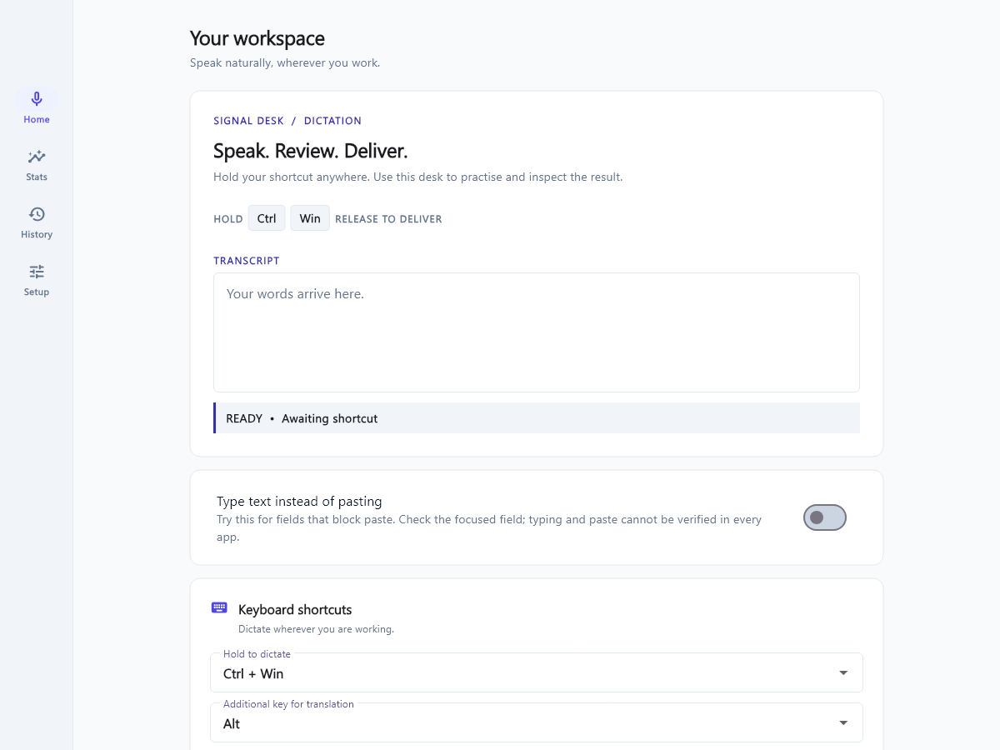
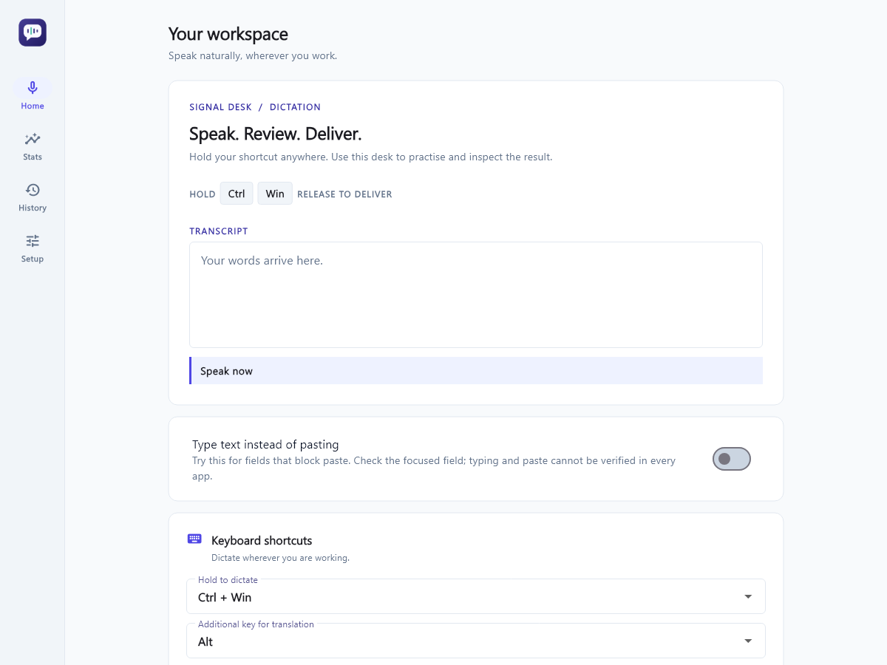
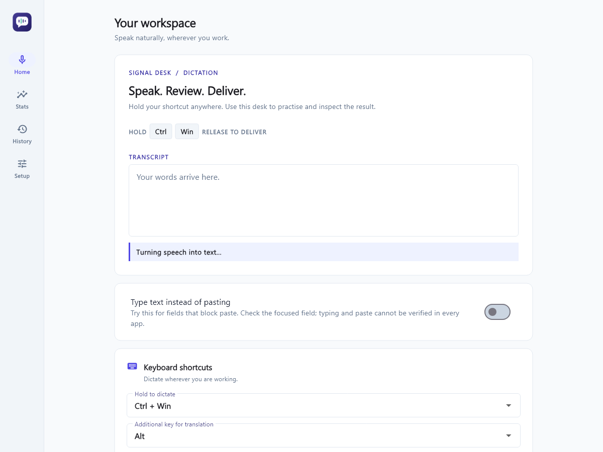
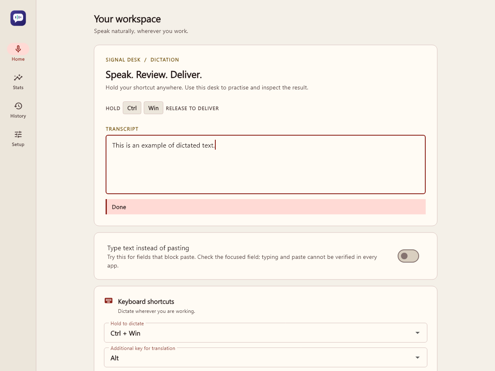

# AI Voice Dictator

Windows 10/11 Flutter desktop dictation using a personal Gemini API key and Velora. Audio is sent to Google's Gemini API for processing. Transcripts are stored locally in SQLite; the API key is stored with Windows secure storage.

## Preview

These previews show the workspace through a dictation session. They are rendered from the app interface with simulated states and example text. The indigo theme shown here is a preview of an upcoming update.

**1. Ready:** Open the workspace to practise dictation and check the keyboard shortcuts.



**2. Dictating:** Focus the playground and hold the dictation shortcut. The status changes to “Speak now”.



**3. Processing:** Release the shortcut. The app sends the recording to Gemini and shows “Turning speech into text”.



**4. Complete:** The transcript appears in the playground and the status changes to “Done”. The image below shows the current released theme.



You can also dictate in other applications with the global shortcuts while a small floating overlay shows recording and processing progress. The completed transcript is copied to the clipboard and saved in local history.

## Download

Get the Windows x64 setup executable from [Releases](https://github.com/md-riaz/ai-voice-dictator/releases).

## Build

On Windows, install Flutter 3.47.9 (the version used by the release workflow), Visual Studio with the **Desktop development with C++** workload, and the Windows SDK. From the repository root, run:

```powershell
flutter pub get
flutter analyze --no-pub
flutter test --no-pub
dart run custom_lint
flutter run -d windows --no-pub
```

To make a release build, run `flutter build windows --release`. The application executable and required runtime files are in `build/windows/x64/runner/Release/`. Distribute the entire directory. To build the installer, use the release workflow described below.

Automated tests use test doubles for Gemini and do not need an API key. A live dictation test needs a Gemini API key configured in the app, a microphone, network access, and permission for desktop apps to use the microphone. Avoid sharing keys, private transcripts, or recordings in logs, issues, or screenshots.

The app's Dart entry point is `lib/main.dart`; `lib/dictation_controller.dart` coordinates dictation, `lib/services/` contains audio, Gemini, and desktop integrations, and `lib/settings/` contains the setup and playground UI. The Windows shortcut hook and overlay live in `windows/runner/flutter_window.cpp`. See [AGENTS.md](AGENTS.md) for implementation and verification guidance.

To publish a new Windows release, update `version` in `pubspec.yaml`, push the change, and run **Windows release** from the repository's Actions tab. The workflow uses the version before the `+` build number as the Git tag and creates an installer; existing tags are rejected.

## Use

On first launch, open Setup, save a Gemini API key, and select and test a microphone. Home includes a playground: click its text box before dictating. Hold Ctrl+Win to dictate, or Ctrl+Win+Alt to translate, and release to finish. Press Ctrl+Win+Space to start hands-free and press it again to finish. Esc cancels recording. A separate non-activating overlay shows progress while the main window stays open. Use the close button or tray menu to keep the app in the system tray, reopen it, pause/resume, or exit.

Gemini can make mistakes. Review inserted text, especially numbers and technical terms. Transcripts remain in local history; recordings are temporary and deleted after processing. The transcript is also copied to the clipboard, including when the active window changes before insertion.
